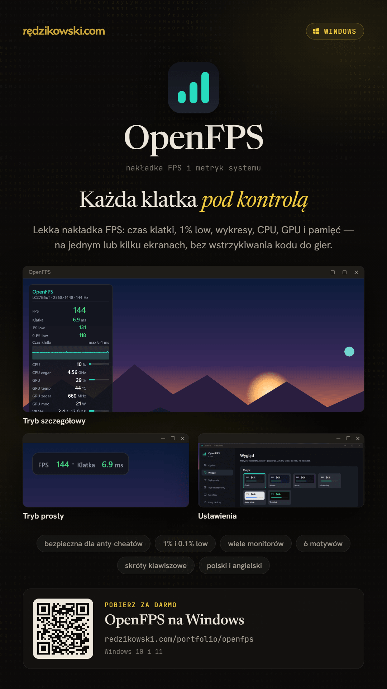

# OpenFPS

<!-- posters:start -->
<p align="center">
  
</p>

<p align="center"><a href="https://redzikowski.com/portfolio/openfps">redzikowski.com/portfolio/openfps</a></p>
<!-- posters:end -->

Lekka, w pełni konfigurowalna nakładka FPS i metryk systemowych dla Windows 10/11, napisana w Rust.

*English summary below.*

---

## Najważniejsze cechy

- **Pomiar FPS bez wstrzykiwania kodu do gier.** OpenFPS korzysta z Event Tracing for Windows (tej samej metody co PresentMon), więc jest bezpieczny dla systemów anty-cheat. Działa z DirectX 9–12, OpenGL i Vulkanem.
- **Dwa tryby:** prosty (kompaktowy pasek, np. `FPS 144 · Klatka 6.9 ms`) i szczegółowy (panel z wykresami i metrykami sprzętu). Przełączasz je skrótem klawiszowym.
- **Wiele monitorów.** Nakładka może działać na dowolnej liczbie ekranów, a każdy pokazuje FPS aplikacji, która jest właśnie na nim. Każdy monitor ma własną pozycję, tryb i skalę.
- **Mało zasobów.** Nakładka rysuje się programowo (bez udziału GPU) i tylko wtedy, gdy zmienią się dane. Zbiera wyłącznie metryki, które są włączone. Po ukryciu niczego nie mierzy.
- **Stały rozmiar.** Nakładka nie zmienia wymiarów w trakcie działania: każda wartość ma zarezerwowaną szerokość.
- **Nie pokazuje nazwy aplikacji.**
- **Polski i angielski** — w nakładce, menu zasobnika i oknie ustawień.

## Dostępne metryki

| Grupa | Metryki |
|---|---|
| Klatki | FPS, czas klatki, 1% low, 0.1% low, wykres czasu klatki, wykres FPS, czas sesji |
| Procesor | użycie CPU, efektywny zegar, obciążenie każdego wątku |
| Karta graficzna | użycie GPU, użycie GPU przez aplikację, VRAM, temperatura, zegar, pobór mocy, wentylator |
| System | RAM, sieć (pobieranie/wysyłanie), dysk (odczyt/zapis), bateria |
| Inne | rozdzielczość i odświeżanie ekranu, godzina, czas pracy systemu |

Każdą pozycję można włączyć lub wyłączyć osobno dla trybu prostego i szczegółowego, a także ustalić jej kolejność.

## Instalacja

Pobierz najnowszy plik `OpenFPS-x.y.z.exe` ze strony aplikacji na
[redzikowski.com](https://redzikowski.com/portfolio/openfps) i uruchom go. To jeden przenośny plik, bez instalatora.
Kolejne wersje program sprawdza i instaluje sam (Ustawienia → O programie).

## Wymagania

- Windows 10 lub 11 (64-bit).
- Do pomiaru FPS: konto, które może śledzić zdarzenia systemowe — administrator albo członek grupy „Użytkownicy dzienników wydajności” (Performance Log Users). Na wielu kontach działa to bez dodatkowych kroków. Jeśli nie, nakładka pokaże komunikat, a w menu zasobnika pojawi się „Uruchom ponownie jako administrator”.
- Temperatura, zegar, pobór mocy i wentylator GPU: karta NVIDIA (biblioteka `nvml.dll` instaluje się ze sterownikiem).

## Budowanie

Potrzebny jest Rust oraz Visual Studio Build Tools z komponentem „C++ build tools” (toolchain MSVC). Plik `rust-toolchain.toml` wybiera go automatycznie.

```bash
cargo build --release
```

Gotowy plik: `target\release\openfps.exe` (ok. 4,8 MB, bez dodatkowych plików). Wydania budują się w GitHub Actions
po wypchnięciu tagu `vX.Y.Z` i trafiają na redzikowski.com.

## Uruchamianie

```bash
target\release\openfps.exe
```

Program działa w tle z ikoną w zasobniku systemowym. Ponowne uruchomienie, gdy już działa, otwiera okno ustawień.

| Argument | Działanie |
|---|---|
| *(brak)* | uruchamia nakładkę |
| `--settings` | otwiera okno ustawień |
| `--no-elevate` | nie prosi o uprawnienia administratora, nawet jeśli włączono tę opcję |

### Skróty klawiszowe (domyślne)

| Skrót | Działanie |
|---|---|
| `Ctrl+Shift+F9` | pokaż / ukryj nakładkę |
| `Ctrl+Shift+F10` | tryb prosty ↔ szczegółowy |
| `Ctrl+Shift+F11` | otwórz ustawienia |
| `Ctrl+Shift+F12` | tryb przesuwania (przeciągnij nakładkę myszą, ten sam skrót kończy) |
| *(nieprzypisany)* | następny motyw |

Wszystkie skróty zmienisz w ustawieniach (strona „Skróty klawiszowe”). Działają globalnie, także w grach.

### Ikona w zasobniku

- **kliknięcie** — pokaż / ukryj,
- **dwuklik** — ustawienia,
- **prawy przycisk** — menu: tryby, przesuwanie, monitory, motywy, język, restart jako administrator, zakończ.

## Ustawienia

Okno ustawień to osobny proces uruchamiany tylko na czas edycji. Każda zmiana jest od razu widoczna na nakładce.

- **Ogólne** — widoczność, domyślny tryb, ukrywanie bez aktywnej gry, ukrywanie na nagraniach i zrzutach ekranu (OBS, Discord), częstotliwość odświeżania, okna uśredniania, autostart, wykluczone procesy.
- **Wygląd** — 6 gotowych motywów (Grafit, Północ, Neon, Minimalny, Jasne szkło, Terminal), czcionka, grubość, rozmiary, skala, wszystkie kolory z przezroczystością, zaokrąglenia, odstępy, obramowanie, cień lub kontur tekstu, paski i wykresy.
- **Tryb prosty / szczegółowy** — kierunek (poziomy lub pionowy), etykiety, nagłówek, wybór i kolejność pozycji.
- **Monitory** — mapa ekranów, włączanie nakładki na każdym z nich, pozycja (siatka 3×3), odsunięcie, tryb i skala osobno dla każdego ekranu.
- **Progi i kolory** — kiedy FPS, obciążenie i temperatura zmieniają kolor na ostrzegawczy.
- **Skróty klawiszowe** — zmiana każdego skrótu przez naciśnięcie nowej kombinacji.

Konfiguracja jest zapisywana w `%APPDATA%\OpenFPS\config.toml`. Plik można też edytować ręcznie, a nakładka wczyta zmiany w ciągu sekundy. Jeśli plik jest uszkodzony, program uruchomi się z ustawieniami domyślnymi i zachowa kopię jako `config.toml.broken`.

### Autostart

Opcja „Uruchamiaj z Windows” dodaje wpis do klucza `Run` w rejestrze użytkownika. Jeśli włączysz też „Zawsze jako administrator”, zamiast tego tworzone jest zadanie w Harmonogramie zadań z najwyższymi uprawnieniami, bo Windows pomija wpisy `Run`, które wymagają UAC.

## Zgłoszenia i aktualizacje

- **Zgłoś błąd lub sugestię** — strona w ustawieniach i pozycja w menu zasobnika. Wiadomość trafia do autora przez
  redzikowski.com. Adres e-mail i informacje o systemie (wersja Windows, liczba wątków CPU, model karty) są opcjonalne.
- **Raport o awarii** — jeśli program zakończy się błędem, przy następnym uruchomieniu zapyta, czy wysłać raport.
  Bez zgody nic nie jest wysyłane, a raport nie zawiera plików ani nazw gier.
- **Aktualizacje** — raz dziennie (można to wyłączyć) program sprawdza nowe wydanie przez redzikowski.com, pobiera je,
  sprawdza sumę SHA-256 i podmienia plik `.exe`. Poza tym program nie łączy się z siecią.

## Jak to działa

- **FPS:** sesja ETW nasłuchuje zdarzeń „Present” od dostawców DXGI, D3D9 i DxgKrnl, z filtrem na identyfikatory zdarzeń (mały narzut). Dla każdego monitora wybierany jest proces, który renderuje w oknie na pierwszym planie, a jeśli go nie ma — największe widoczne okno renderujące na tym ekranie.
- **1% / 0.1% low:** wartości wyliczane z 99. i 99,9. percentyla czasu klatki z ostatnich kilku sekund (długość okna można ustawić).
- **Metryki systemowe:** liczniki wydajności Windows (angielskie nazwy, więc działa na każdej wersji językowej systemu), NVML dla kart NVIDIA, DXGI do odczytu pamięci karty.
- **Rysowanie:** Direct2D i DirectWrite z programowym rasteryzatorem do warstwowego okna, przezroczystego dla myszy. Proces działa w trybie „Efektywność” (EcoQoS).

### Zmierzone zużycie zasobów

Build release, przykładowy komputer z kartą RTX 4070 Ti, pomiar przez 30 s:

| Scenariusz | CPU (jeden rdzeń) |
|---|---|
| Tryb szczegółowy | ok. 0,5% |
| Tryb prosty | ok. 0,2–0,3% |
| Nakładka ukryta | ok. 0,05% |

Pamięć prywatna: ok. 35 MB, przy czym większość zajmuje biblioteka NVML i rasteryzator Direct2D. Po ukryciu nakładki zajęta pamięć RAM spada do ok. 2 MB.

## Ograniczenia

- **Pełny ekran wyłączny** (exclusive fullscreen): nakładka nie jest widoczna nad grami w tym trybie. Większość współczesnych gier używa trybu bez ramek lub flip-model, gdzie nakładka działa.
- **Przeglądarki:** FPS zwykle nie jest wykrywany, bo renderuje osobny proces GPU, który nie ma własnego okna.
- **Czujniki GPU** (temperatura, zegar, pobór mocy, wentylator) tylko dla kart NVIDIA. Użycie GPU i VRAM działają na każdej karcie.
- **Temperatura CPU** nie jest obsługiwana (wymagałaby sterownika jądra).

## Struktura projektu

```
src/
  main.rs            punkt wejścia (nakładka lub --settings)
  config.rs          konfiguracja TOML z wartościami domyślnymi
  presets.rs         gotowe motywy
  i18n.rs            tłumaczenia PL / EN
  hotkey.rs          zapis i odczyt skrótów
  monitors.rs        monitory: geometria, DPI, odświeżanie, nazwy z EDID
  icon.rs            ikona rysowana proceduralnie
  util.rs            Win32: uprawnienia, autostart, komunikacja procesów, wersja
  feedback.rs        zgłoszenia i raporty o awariach do redzikowski.com
  update.rs          aktualizacje z redzikowski.com z weryfikacją SHA-256
  metrics/
    etw.rs           pomiar FPS przez ETW i statystyki klatek
    pdh.rs           liczniki wydajności Windows
    nvml.rs          czujniki NVIDIA
    mod.rs           kolektor: włącza tylko potrzebne źródła
  overlay/
    mod.rs           okno w tle, zasobnik, skróty, okna nakładki
    content.rs       zamiana metryk na treść nakładki
    render.rs        układ i rysowanie (Direct2D / DirectWrite)
  settings/
    mod.rs           okno ustawień (egui) i jego strony
    theme.rs         paleta, typografia, odstępy
    widgets.rs       kontrolki: przełącznik, segmenty, kolory, kotwica
    extras.rs        strona zgłoszeń i karta aktualizacji
build.rs             ikona .exe (z src/icon.rs) i metadane pliku
```

Pomysł i wykonanie: Adam Rędzikowski · [redzikowski.com](https://redzikowski.com) · [Postaw kawę](https://buycoffee.to/adamredzikowski)

---

## English summary

OpenFPS is a lightweight, highly customizable FPS and system metrics overlay for Windows 10/11, written in Rust.

- **Anti-cheat safe FPS capture** via Event Tracing for Windows (the PresentMon approach) — nothing is injected into games. Supports DirectX 9–12, OpenGL and Vulkan.
- **Simple and detailed modes**, switched with a hotkey.
- **Multi-monitor:** each display shows the FPS of the app on that display, with its own position, mode and scale.
- **Low overhead:** software-rendered only when data changes, collects only enabled metrics, and stops collecting entirely when hidden (about 0.2–0.5% of one core while visible).
- **Fixed size:** the overlay never resizes while running. It never shows the application name.
- **Polish and English** UI.

Download `OpenFPS-x.y.z.exe` from [redzikowski.com](https://redzikowski.com/portfolio/openfps) or build with `cargo build --release` (MSVC toolchain). Bug reports, suggestions and opt-in crash reports go to the author via redzikowski.com, and the app checks for updates once a day (SHA-256 verified, can be turned off). Default hotkeys: `Ctrl+Shift+F9` show/hide, `Ctrl+Shift+F10` mode, `Ctrl+Shift+F11` settings, `Ctrl+Shift+F12` move with mouse. Configuration lives in `%APPDATA%\OpenFPS\config.toml`.

FPS capture needs an account that can trace system events (administrator or Performance Log Users). GPU temperature, clock, power and fan readings require an NVIDIA card. The overlay is not visible over exclusive fullscreen games.
